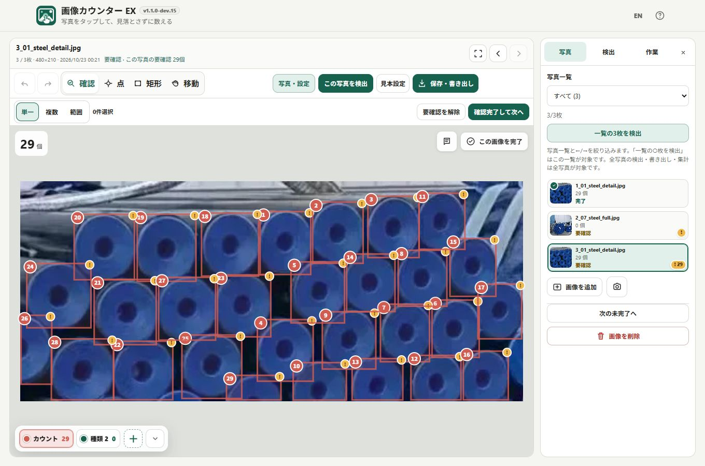

# Image Counter EX

Detection starts at **Standard**. Try **Find more** for missed objects or **More selective** for fewer unwanted results, then review the boxes. The built-in model uses **FP32** computation: its stored weights are FP16, but computation remains FP32. See the [diagnosis and validation](docs/DETECTION_ACCURACY.md).

[](https://github.com/ttomohisa/htmlapps-image-counter-ex/actions/workflows/deploy-pages.yml)
[](https://ttomohisa.github.io/htmlapps-image-counter-ex/)

[日本語版 README](README.ja.md)

> **Embedded-model build — 1.1.0-dev.19.** The single HTML includes the 6.44 MiB YOLOE-26n model. No separate model selection is needed. The user reported successful Android Chrome operation with 1.1.0-dev.3; the newer photo workspace, detection, review, photo-filtering, bulk-delete, example-editing and pinch workflows still need physical-device confirmation.


A privacy-focused, single-HTML app for **counting objects in photos manually or with reviewed local detection candidates**. Place point or rectangle markers yourself, keep track of what has already been counted, flag uncertain items for review, and export the result without uploading your images to a server.

If no examples are saved for the selected type, the main action opens example setup. Nearby text explains ongoing photo loading or processing. The built-in model is used automatically.

For repeated inspections, draw examples once and choose **Save & detect**. The app saves them for the selected type, adds detection results as **Needs review**, and returns to the photo for checking. Other photos can use the same examples with **Detect this photo** or **Detect all photos**. Saved examples remain available in browser autosave and saved work HTML, even after removing their original photo.

## 🚀 Live demo

### [Open Image Counter on GitHub Pages](https://ttomohisa.github.io/htmlapps-image-counter-ex/)

GitHub Pages delivers the initial HTML. After it loads, image decoding, counting, marker editing, camera handling, autosave, image correction, and export are processed locally on your device. Images selected in the app are not uploaded by the app.

The initial HTML includes the model and detection runtimes, so opening it can take time on a slower connection or device. A startup notice remains until the app is ready. The self-extract variant shows **Loading application file**, **Unpacking locally**, then **Starting**. Detection assets are decoded when you run Detect; they are already included in the initial file. These notices explain the wait; they do not promise faster loading.

[](https://ttomohisa.github.io/htmlapps-image-counter-ex/)

Undo / Redo results also auto-save. Resetting image corrections returns the image to in-progress. During rapid viewer navigation, images and counts switch together; a decoding failure keeps the previous image and lets you retry or select another.


## Features

- **Count manually, without losing your place** — Tap to place point markers or drag rectangles around objects. Each marker is one count.
- **Correct mistakes after counting** — Move point markers, move or resize rectangles, change the marker type, delete a marker, and use Undo / Redo. Interrupted pointer actions discard pending counts and restore moved/resized geometry without clearing redo. Starting a pinch also discards an unfinished marker edit.
- **Review and remove unwanted results** — Review mode selects existing markers without adding or moving them. Select one, tap several, or drag a range, then delete the selection with one Undo for the whole deletion.
- **Switch counting types directly on the image** — Use the translucent type dock on the canvas, or number keys `1`–`9` on desktop. The dock can be minimized when it covers an object.
- **Flag uncertain items for later review** — Add an independent **Needs review** flag without changing the marker type or count. Images with unresolved review markers cannot be marked complete.
- **Work through multiple photos** — Filter the thumbnail list by photo status and move between matching photos. Counts show progress across the whole project. **Review complete & next** reviews and completes a photo, then moves to the next incomplete one.
- **Adjust hard-to-see photos without changing the original** — Brightness, contrast, grayscale, and 90° rotation are non-destructive and are preserved in exports.
- **Capture photos from the camera** — Review a capture before adding it, retake it, or accept it and continue shooting.
- **Resume or carry your work** — Autosave in this browser, or use **Save → Save work as HTML** to keep photos, saved examples, markers and review progress in a file. Choose **Open work** to resume editing.
- **Export results in practical formats** — Saved work HTML opens directly as a read-only viewer. You can also export a ZIP containing `markers.csv` and `summary.csv`, with optional annotated JPEG images.
- **Share a viewer without giving up the data** — The exported viewer can switch images, toggle marker visibility, show image information and comments, and re-export JPEG / CSV+JPEG ZIP. Import it back into Image Counter to resume editing.
- **Private local runtime** — No account, analytics, remote font, runtime CDN, or image upload. Runtime networking is blocked by CSP with `connect-src 'none'`.

## Quick start

### Use the web demo

Open the [GitHub Pages demo](https://ttomohisa.github.io/htmlapps-image-counter-ex/). No installation or account is required.

### Use the standalone HTML

1. Download `dist/index.html` from this repository.
2. Open it in a current Chromium-based browser, Firefox, or Safari.
3. Add photos and start counting. No local web server is required for normal file-based use.

### Rebuild the single HTML (advanced)

1. Download or clone this repository.
2. On Windows 10/11, double-click `build-standalone.bat`.
3. Use the generated `dist/index.html` as the normal standalone app.
4. `dist/index.self-extract.html` is also generated as a gzip self-extracting variant.

The first build downloads pinned ONNX Runtime JS/WASM packages. Generated HTML embeds them; no runtime library download is needed. The compact YOLOE-26n model is also embedded; there is no additional runtime download.

## Try automatic detection

1. Select the type you want to count. Choose **Add examples to start** beside the photo, or open examples from the **Detection** panel.
2. Draw one or more examples around individual objects. Choose **Save & detect** to save those examples for this type and detect the current photo, or **Save & close** to register them for later.
3. Check the results in the photo's **Review** mode. New automatic markers are **Needs review**. Remove unwanted markers, correct boxes or add missed objects manually, then choose **Review complete & next**.

After examples are saved, **Detect this photo**, **Detect all photos**, and the filtered **Detect list (N)** action use them directly. Every successfully processed photo needs review, including zero or duplicate-only results. Detection runs use the built-in compact model automatically; there is no model upload, processor or precision setting.

### Edit saved examples

Open **Edit examples** in the **Detection** panel to adjust the saved source image, even if its original photo has been removed. **Add** draws another box; **Select / edit** selects a box from the image or numbered list. Drag inside a selected box to move it, use its corners to resize it, or enter percentage bounds. **Delete selected example** removes only that box.

Pinch or use **− / +** to zoom from 1× to 8×. Two fingers pan; **Pan view** enables one-pointer panning. **Fit** restores the whole image. Zoom changes only the view, not saved coordinates or inference inputs.

Choose **Use this photo for new examples** to draw a fresh set on the currently selected photo. Your previous saved examples remain unchanged until a valid save. Closing the editor discards unsaved edits; a changed save is reversible with one Undo. Interrupted gestures and a second finger discard unfinished box edits. At least one valid example is required to save. Small valid boxes remain usable when saving and editing, including near image edges; their saved positions and sizes stay unchanged. Very small objects can still be difficult to detect, so check the results. Editing examples alone never changes counts.

### Run and review

The **Detection** panel keeps sensitivity, the current photo's detection region and rerun behavior beside the detection actions. Start with **Standard**; use **Find more** for misses or **More selective** for fewer unwanted results. Detection uses original pixels, without brightness or contrast display corrections.

**Add detections** preserves existing markers. **Replace unreviewed auto results** updates only eligible automatic markers of the selected type inside the detection region. Manual, reviewed, edited, other-type and older-version markers stay intact. A valid zero result can remove eligible old results; failed, cancelled or incomplete results cannot. Moving, resizing, changing type or toggling a marker's review flag removes its replacement eligibility.

**Detect all photos** includes completed photos. A run prepares the model and saved examples once for its captured target list and reports elapsed time including preparation. **Stop** keeps already processed photos; one **Undo** restores the entire run. No other work can be edited while detection is running. Leaving the page stops inference and releases its runtime.

After review, **Review complete & next** clears the photo's review flags, completes it and moves to the next unfinished photo, wrapping once. If all photos are complete, it stays on the current photo. To stay on the photo, open **Project → Photo review**: **Clear review flags** clears review state without changing completion, while the separate completion control completes or reopens it without navigation. These operations remain undoable.

The user reported successful Android Chrome operation with dev.3. Physical Android verification of the newer editor and detection flow remains pending; successful HTTP tests do not establish direct-file support. See the [device checklist](docs/ANDROID_FILE_TEST.md).

## Detection area and filtered runs

Use **Detect list (N)** beside the filter in **Photos** to process only the matching photos. The list is captured when you start: photos remain in that run even if detection changes their status. **Detect all photos** still processes the whole project. Stop and one Undo work across the processed part of either run.

Set an optional detection rectangle for each target photo by drawing or entering numeric bounds, then save it. Cancel discards pending changes. To restore full-image detection, choose Full image and then Save region. A saved change reopens photo completion, preserves all existing markers and supports Undo. Regions survive draft restoration and saved-work reopening, including compressed photos; older work uses the full image.

Detection still analyzes the full image and accepts boxes only when their centers are inside the rectangle, including its boundary. It does not crop inference or promise better small-object accuracy or speed. **Replace unreviewed auto results** preserves eligible automatic markers outside the region, as well as its existing protected markers. Counts and CSV/JPEG exports include all markers.

## Photo-first workspace

The photo remains the main working area in every mode. Switch between **Photos**, **Detection** and **Project** in one tools panel: Photos holds the list, filter and photo actions; Detection holds example editing, regions and detection settings; Project holds photo-review actions, totals, types, display and browser-storage settings. The action row groups detection, **Review complete & next** and **Save** beside the mode controls. Review highlights the next-photo action; other modes highlight detection. The selection row appears only in Review.

The photo header's **Open panel** button restores the panel after you close it with ×. While open, the button reads **Hide panel**. On desktop, the panel sits to the right and scrolls independently. On narrow screens, it temporarily replaces the photo area; **Return to photo** brings it back. The phone bottom bar offers Undo, Redo, previous/next photo and Save in Review, or Undo, Redo, Add, Types and Save in other modes. Panel choices are temporary and reset when you open different work. Physical Android checks for the new workspace remain pending.

## Usage

1. Add one or more JPG / JPEG / PNG / WebP images, or use the camera. A readable SVG is converted locally to PNG when added, while keeping its original filename and format metadata.
2. Choose **Point** or **Rectangle** to add counts, **Review** to inspect them, or **Move** to pan.
3. Select the active counting type from the translucent dock along the bottom of the canvas. On desktop, keys `1`–`9` also switch types.
4. In Point mode, tap/click an object once. In Rectangle mode, drag around one object.
5. In Review, select existing markers to inspect or delete them. Choose **Single**, select a marker and choose **Edit** to move it or resize a rectangle from its four corner handles.
6. In Review's Single selection, use the flag button to set or clear **Needs review** while staying in Review. Review automatic results even when no new markers were found.
7. Use the memo button at the upper-right of the photo to add an image note. On desktop the memo panel can be dragged within the canvas; on mobile it opens below the canvas.
8. Check the photo, then choose **Review complete & next**, or use the status filter in **Photos** to work through matching photos with Previous / Next or arrow keys.
9. Open **Save** (in the bottom bar on mobile), enter a filename, and choose **Save work as HTML** or save a results ZIP. Clear **Include annotated JPEGs** to export only the two CSV files.

The top-right EN / JA and Help controls remain available on narrow screens. **How to use & notes** starts with three steps and four short notes about AI review, saving, privacy and loading time. Optional control and saving tips are collapsed. License, source-code and build information are preserved. Help keeps its heading visible while the contents scroll. At phone widths, the start screen has full-width photo/camera buttons; Build info and the page footer are hidden as before. Build info remains available on wider screens.

### Keyboard shortcuts

| Shortcut | Action |
| --- | --- |
| `1`–`9` | Switch to the corresponding counting type |
| `←` / `→` | Move to the previous / next photo matching the filter |
| `Ctrl` / `⌘` + `Z` | Undo |
| `Ctrl` / `⌘` + `Shift` + `Z` | Redo |
| `Esc` in Review | Clear selection |
| `Delete` / `Backspace` in Review | Delete selected markers |

Use these shortcuts while the canvas has focus. They are inactive while a form control, button or editable field has focus, or while a dialog is open.

## Counting and review workflow

### Point and rectangle markers

Point markers are fast for ordinary counting. Rectangle markers are useful when the target is dense, small, or easier to identify by outlining it. Marker numbers restart from `1` for each counting type, while image and project totals are tracked separately.

### Review and delete a selection

Choose **Review** to check existing markers; it opens in **Single**. Tapping blank space never adds a count, and dragging in Single or **Multiple** pans the photo without moving a marker. In Single, the selected marker offers a review-flag toggle and **Edit**. Toggle the flag while staying in Review, or choose Edit to keep the marker selected and switch to Point or Rectangle for position/size changes. Multiple and **Range** hide this popover, even with one marker selected.

- **Single** selects one visible marker.
- **Multiple** adds or removes each tapped visible marker from the selection.
- **Range** adds visible markers whose centers fall inside the dragged rectangle. Use two fingers to pan or zoom in this submode.

Check the selected count, use **Clear selection** to start again, or choose **Delete selected**. Deletion affects only those markers in the current photo, returns it to incomplete and supports one Undo for the entire deletion. Other photos and detection-review checks stay intact, so deleting all unwanted boxes does not by itself complete the review.

Hidden markers cannot be selected. Selection is temporary and is cleared or pruned when you change photos or modes, hide markers, use Undo/Redo or start detection. An interrupted range drag or pinch discards only the unfinished selection. Selection is not included in saved work; deletion and its Undo/Redo are autosaved.

### Needs review

**Needs review** is a flag layered on top of a normal marker. It does not create another marker type and does not change the count. Flagged markers show an amber `!` badge, and the remaining review count is visible in the image list and project summary.

The photo status also tracks a pending detection check. A zero-result or duplicate-only detection therefore shows **Needs review** with zero flagged markers until you review the photo. The standalone completion control in **Project → Photo review** waits for both marker flags and detection checks to be reviewed.

Thumbnails and the current-photo bar show **Undetected**, **In progress**, **Needs review** or **Complete**; the summary counts photos in each state. Needs review takes priority over completion. A manually counted photo is In progress, and an untouched old project is not treated as previously detected. Review state is retained in drafts and viewer HTML imports.

### Filter photos by status

Use **Photo list** immediately above the thumbnails to choose **All**, **Undetected**, **In progress**, **Needs review** or **Complete**. Its option counts always cover the whole project; the matching/total count shows how many thumbnails are included. Choose **Show all** to reset to All. A photo with a pending detection check belongs to Needs review even when it has no flagged markers.

The current photo stays on the canvas if it falls outside the filter, with **Current photo is outside this filter** explaining why its thumbnail is absent. Previous / Next and `←` / `→` visit only matching photos in project order and stop at either end. From an excluded photo, they choose the nearest match before or after it. If there are no matches, the list shows **No photos match** and both directions are unavailable.

The filter stays selected as you edit, review, use Undo/Redo or change language in the same project. New work, Open work, draft restoration and page reload start at All. Filtering does not change counts or saved data. Summaries, exports, **Detect all photos**, **Next incomplete** and **Review complete & next** still cover the entire project, so those navigation actions can open a photo outside the filter.

### Image display correction

Use **Display correction** when the source photo is dark or low-contrast. The correction panel stays out of the way so you can watch the image while adjusting:

- Brightness
- Contrast
- Grayscale amount
- 90° rotation

The original source image is not overwritten.

## Save and reopen work

Choose **Save → Save work as HTML** to download photos, saved examples, markers and review progress in one file. The save uses the content and filename present when you press Save. The saved HTML opens directly as a **read-only result viewer**; it contains the work data but not the editor or detection model.

It includes:

- project total, completion, and needs-review summary
- per-type totals
- thumbnails plus Previous / Next / `←` / `→` navigation
- annotated point / rectangle markers with per-type numbering
- marker, number, and per-type visibility controls
- structured image information: filename, captured time/source, dimensions, original format/size, completion state, count, and needs-review count
- a dedicated **Comment** card for the image note
- current annotated JPEG download
- CSV + all annotated JPEG images ZIP download

Viewer-side downloads show a confirmation dialog before the file is saved.

To edit again, choose **Open work** on the app’s start screen or in **Save / export**. Existing viewer HTML files remain compatible. If another work project is open, the app checks the file first and then asks before replacing that project and the browser autosave. Cancel to save your current work first; an invalid file leaves it unchanged.

## Export files

### CSV + optional annotated image ZIP

In the editor, **Include annotated JPEGs** is checked by default. Clear it to save only `markers.csv` and `summary.csv` without decoding or rendering images. The choice lasts until the page is reloaded; it is not part of your saved project. CSV contents and editable ZIP filenames stay the same in either mode. The exported viewer still includes JPEGs in its ZIP. ZIP files use the content, display settings and filename present when export starts, so later edits or opening another work do not mix results into that export.

Default contents:

```text
result.zip
├─ markers.csv
├─ summary.csv
└─ images/
   ├─ 01-counted-....jpg
   └─ 02-counted-....jpg
```

`markers.csv` contains image metadata, captured time (`image_captured_at`) and its source (`capture_time_source`), display corrections, point/rectangle shape, needs-review state, per-type numbering, category information, normalized coordinates, pixel coordinates, and rectangle dimensions.

`summary.csv` contains per-image, per-type, and project-level counts, including `review_count`.

### Saved HTML image compression

**Compress saved photos** converts photos to WebP to reduce file size. Turn it off to preserve fine detail for later inspection. Saved example snapshots stay unchanged. Annotated images in CSV + image ZIP exports remain JPEG.

## Camera and captured time

For image metadata, Image Counter uses:

1. JPEG EXIF capture time when available (`DateTimeOriginal` / related EXIF date fields)
2. the selected file timestamp when EXIF capture time is unavailable
3. the actual capture time for photos taken through the in-app camera

The captured time and its source are preserved in Viewer HTML and CSV exports.

## Local draft storage

The previous-work banner closes after you successfully open new photos, a sample, or viewer HTML. Cancelling file selection or a failed import keeps the saved work available to continue. Its summary, control names, and tooltips follow the selected Japanese/English language.

Projects are autosaved to IndexedDB on supported browsers. This copy belongs to this browser and page; it does not transfer to another device and can be lost when browser data is cleared. Save important work as HTML too. The app can show:

- current project data size
- saved draft size
- available browser storage when the browser exposes it

Draft image copies can be converted to WebP to reduce local storage usage. This compression applies to the autosaved copy; logical image dimensions and marker coordinates are preserved. If you switch work during compression, the previous save cannot mix photos into the new work or change its save status.

## Publish with GitHub Pages

The repository includes a workflow that builds the standalone HTML and deploys `dist/` to GitHub Pages.

1. Push the repository to GitHub as `htmlapps-image-counter-ex`.
2. Open **Settings → Pages → Build and deployment → Source** and select **GitHub Actions**.
3. Push to `main`, or manually run **Deploy standalone app to GitHub Pages** from the Actions tab.
4. After a successful deployment, the app is available at `https://ttomohisa.github.io/htmlapps-image-counter-ex/`.

The workflow runs the repository checks before publishing. If Pages is not enabled yet, the build still runs and the workflow summary explains the one-time setup step.

## Development and build layout

The default build also refreshes the tracked `image-counter.html` release alias. Commit that file with source changes. Custom `-OutputPath` builds leave it unchanged. Run `scripts/check-repository.ps1` with Node.js 24 available to verify alias freshness and release/camera regressions; the check reports stale aliases without overwriting them.

Edit `src/index.template.html`, not the generated `dist/index.html`.

```text
.
├─ src/index.template.html       # Application source template
├─ app.config.json               # App identity and build settings
├─ dependencies.json             # Embedded runtime dependency list (pinned ORT assets)
├─ build-standalone.bat          # Windows build entry point
├─ build-standalone.ps1          # Standalone HTML builder
├─ scripts/                      # Verification and self-extract build scripts
├─ assets/                       # Favicon and README screenshots
├─ dist/index.html               # Generated standalone app
└─ .github/workflows/
   ├─ build-standalone.yml       # Pull request / manual validation
   └─ deploy-pages.yml           # GitHub Pages deployment
```

The build process verifies the generated single HTML, creates build manifests, and creates the optional self-extracting HTML variant.

## Privacy and runtime network protection

The generated HTML is designed to keep selected images on the device:

- Content Security Policy includes `connect-src 'none'`
- no runtime CDN or remote font
- no analytics or telemetry
- no account or backend
- image files and marker data are not uploaded by the app
- camera frames are handled by local browser media APIs

The GitHub Pages version still requires the initial HTML request. For use with the network completely disconnected, open `dist/index.html` locally.

## Limitations

- Local detection is experimental: false positives and missed objects require human review. Process one photo or all photos sequentially using saved examples; tiles are not included.
- One project supports up to 30 images in the current UI.
- Individual image inputs and stored image payloads are limited to 35 MiB; the project limit is 220 MiB including image payloads and metadata.
- SVG and other formats the browser can decode outside the saved-work raster list are converted to PNG when added, limited to 20 megapixels and 16,384 pixels per axis. Conversion failure leaves the image unadded. Existing saved work containing raw SVG is still rejected; newly added SVGs save as raster images.
- Large or high-resolution multi-image projects can consume substantial device memory and browser storage.
- Live camera availability depends on browser permissions and secure-context behavior. Device camera / file-input fallback remains available.
- Capture-time EXIF extraction is focused on JPEG metadata; other formats generally use the source file timestamp.
- XLSX export is not included in v1.0.0.

## Dependencies

Image Counter EX embeds ONNX Runtime Web 1.29.0 (CPU/WASM) and 1.27.0 (WebGPU), both MIT. Models have separate terms. See [THIRD_PARTY_NOTICES.md](THIRD_PARTY_NOTICES.md).

## Contributing

Bug reports and feature proposals are welcome through GitHub Issues. See [CONTRIBUTING.md](CONTRIBUTING.md) for development guidance.

## License

Copyright © 2026 ttomohisa

The model-integrated release is published under [GNU AGPL v3](LICENSE), retaining the [historical MIT notice](LICENSE-MIT). The model, original public checkpoint and conversion source are supplied in this repository. See [third-party notices](THIRD_PARTY_NOTICES.md).

Camera capture stops when its dialog closes. Pending permission requests are discarded and their tracks stopped when they finish.

### Safe imports and spreadsheet text

Viewer HTML imports validate the native project format and embedded raster images before replacing your work. SVG/external images, invalid data, more than 30 images, payloads over 35 MiB per image or projects over the 220 MiB image-plus-metadata budget are rejected. The HTML file itself has a 661 MiB pre-read ceiling allowing encoding overhead. Large files may still exceed your browser’s available memory. Existing oversized or SVG-based exports need reducing/converting first.

CSV text that resembles a formula is prefixed with an apostrophe in both editor and viewer exports. Numbers remain numeric; your project text is unchanged. Some spreadsheet programs display the apostrophe. Do not strip this protection from untrusted text.
