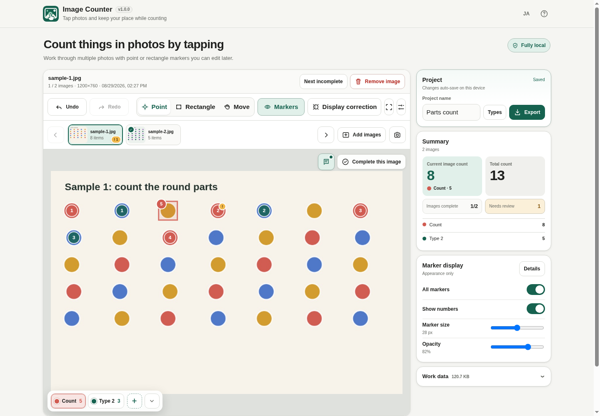
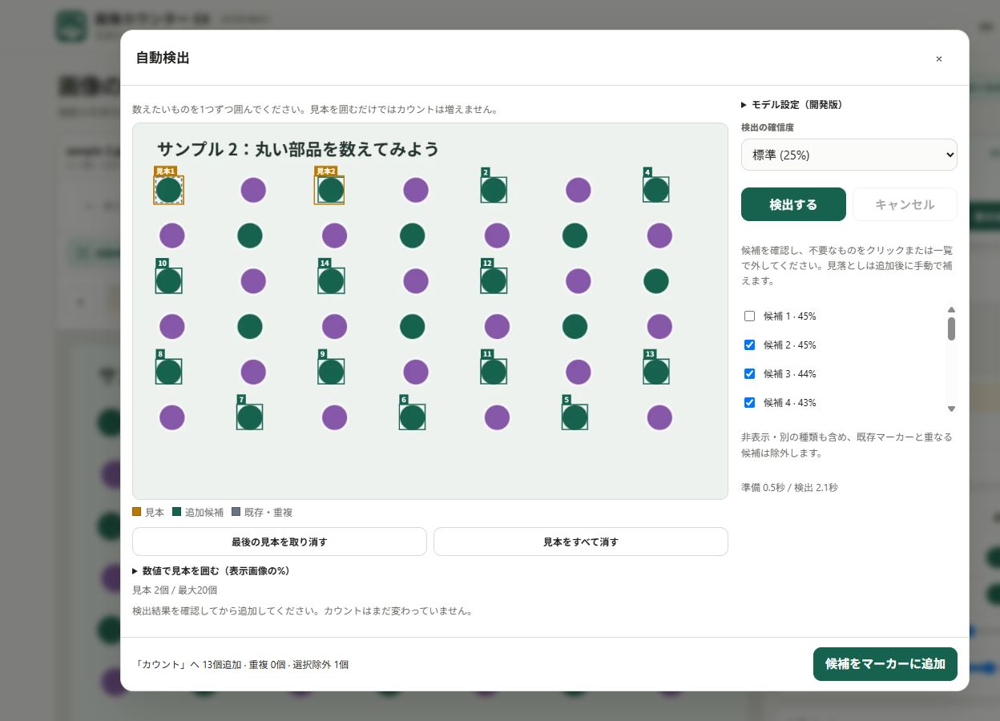

# Image Counter EX

Detection starts at **5%**. Try **1%** for missed objects or 10–50% for fewer unwanted candidates, then review the boxes. Scores are not accuracy percentages. The built-in model uses **FP32** computation: its stored weights are FP16, but computation remains FP32. See the [diagnosis and validation](docs/DETECTION_ACCURACY.md).

[](https://github.com/ttomohisa/htmlapps-image-counter-ex/actions/workflows/deploy-pages.yml)
[](https://ttomohisa.github.io/htmlapps-image-counter-ex/)

[日本語版 README](README.ja.md)

> **Embedded-model build — 1.1.0-dev.11.** The single HTML includes the 6.44 MiB YOLOE-26n model. No separate model selection is needed. The user reported successful Android Chrome operation with 1.1.0-dev.3; the newer detection, review, example-editing and pinch workflows still need physical-device confirmation.


A privacy-focused, single-HTML app for **counting objects in photos manually or with reviewed local detection candidates**. Place point or rectangle markers yourself, keep track of what has already been counted, flag uncertain items for review, and export the result without uploading your images to a server.

Pin examples for repeated inspections: after outlining, choose **Pin these examples**. Each counting type keeps its own reference. Other photos can use **Detect** immediately; after review, **Add and detect next** advances through the image list. Pinned references survive draft restoration and viewer HTML import, even if the original photo is removed. Use **Add / edit examples** to adjust them on the saved image, or **Unpin examples** to start over on another photo. Results still need checking on every photo.

## 🚀 Live demo

### [Open Image Counter on GitHub Pages](https://ttomohisa.github.io/htmlapps-image-counter-ex/)

GitHub Pages delivers the initial HTML. After it loads, image decoding, counting, marker editing, camera handling, autosave, image correction, and export are processed locally on your device. Images selected in the app are not uploaded by the app.

The initial HTML includes the model and detection runtimes, so opening it can take time on a slower connection or device. A startup notice remains until the app is ready. The self-extract variant shows **Loading application file**, **Unpacking locally**, then **Starting**. Detection assets are decoded when you run Detect; they are already included in the initial file. These notices explain the wait; they do not promise faster loading.

[](https://ttomohisa.github.io/htmlapps-image-counter-ex/)

Undo / Redo results also auto-save. Resetting image corrections returns the image to in-progress. During rapid viewer navigation, images and counts switch together; a decoding failure keeps the previous image and lets you retry or select another.


## Features

- **Count manually, without losing your place** — Tap to place point markers or drag rectangles around objects. Each marker is one count.
- **Correct mistakes after counting** — Move point markers, move or resize rectangles, change the marker type, delete a marker, and use Undo / Redo. Interrupted pointer actions discard pending counts and restore moved/resized geometry without clearing redo. Starting a pinch also discards an unfinished marker edit.
- **Switch counting types directly on the image** — Use the translucent type dock on the canvas, or number keys `1`–`9` on desktop. The dock can be minimized when it covers an object.
- **Flag uncertain items for later review** — Add an independent **Needs review** flag without changing the marker type or count. Images with unresolved review markers cannot be marked complete.
- **Work through multiple photos** — See Not detected / In progress / Needs review / Complete states and status totals. **Review complete & next** reviews and completes a photo, then moves to the next incomplete one.
- **Adjust hard-to-see photos without changing the original** — Brightness, contrast, grayscale, and 90° rotation are non-destructive and are preserved in exports.
- **Capture photos from the camera** — Review a capture before adding it, retake it, or accept it and continue shooting.
- **Resume or carry your work** — Autosave in this browser, or use **Save / export → Save work as HTML** to keep photos, pinned examples, markers and review progress in a file. Choose **Open work** to resume editing.
- **Export results in practical formats** — Saved work HTML opens directly as a read-only viewer. You can also export a ZIP containing `markers.csv` and `summary.csv`, with optional annotated JPEG images.
- **Share a viewer without giving up the data** — The exported viewer can switch images, toggle marker visibility, show image information and comments, and re-export JPEG / CSV+JPEG ZIP. Import it back into Image Counter to resume editing.
- **Private local runtime** — No account, analytics, remote font, runtime CDN, or image upload. Runtime networking is blocked by CSP with `connect-src 'none'`.

## Quick start

### Use the web demo

Open the [GitHub Pages demo](https://ttomohisa.github.io/htmlapps-image-counter-ex/). No installation or account is required.

### Use the standalone HTML

1. Download `dist/index.html` from this repository.
2. Open it in a current Chromium-based browser, Firefox, or Safari.
3. Add photos and start counting. No local web server is required for normal file-based use.

### Rebuild the single HTML (advanced)

1. Download or clone this repository.
2. On Windows 10/11, double-click `build-standalone.bat`.
3. Use the generated `dist/index.html` as the normal standalone app.
4. `dist/index.self-extract.html` is also generated as a gzip self-extracting variant.

The first build downloads pinned ONNX Runtime JS/WASM packages. Generated HTML embeds them; no runtime library download is needed. The compact YOLOE-26n model is also embedded; there is no additional runtime download.

## Local auto detection

Use **Add / edit examples** to adjust a pinned reference on its saved source image. Choose **Add** to draw another box, or **Select / edit** to select a box on the image or by its number in the example list. Drag inside the selected box to move it, drag any of its four corner handles to resize it, or change the percentage bounds and choose **Update selected example**. Boxes stay within the image. Delete removes only the selected example; it is unavailable with no selection. These controls also work for examples before pinning them.

For small boxes, pinch the preview or use **− / +** to zoom from 1× to 8×. Move two fingers together to pan, or choose **Pan view** and drag with one pointer. **Fit** restores the whole image. The controls stay beside the preview, and the corner handles stay the same screen size. Choosing Add or Select / edit exits Pan view and keeps the view; closing the dialog or changing its source resets it. Zoom changes only the view, so saved boxes, source pixels and detection inputs are unchanged.

Pinned changes stay pending until **Save example changes**; one **Undo** restores the previous reference. **Discard changes** or closing the dialog keeps the saved reference. Interrupted pointer actions or a second touch discard the unfinished add, move or resize; a pinch keeps the selected example, and lifting the remaining finger cannot commit the abandoned edit. Example edits do not change counts. **Unpin examples** starts over on the current photo. Dashed boxes are existing count markers and are hidden by default; overlapping results cannot be counted again.

Pin examples for the selected type in **Examples / detection settings**. Then use **Detect this photo** or **Detect all photos** directly beside the canvas. All-photo detection includes completed photos. Choose **Add detections** (default) to keep existing markers, or **Replace unreviewed auto results** to refresh only unreviewed, untouched automatic markers of the selected type. New results are marked **Needs review**, and overlaps with retained markers are skipped.

Replacement protects manual, reviewed, edited and other-type markers. It also protects results made before dev.10, whose automatic origin cannot be reliably identified. Moving, resizing, changing type or toggling review protects a marker from later replacement; marking it Needs review again does not undo that protection. Each photo changes only after successful detection. A valid zero-result replacement can remove the eligible old results; failed, cancelled or incomplete replacement results keep them. **Stop** keeps processed photos, and one **Undo** restores the whole run.

A main-screen detection run prepares the model and pinned examples once, then reuses them across its photos. This avoids repeating preparation for every photo. The result shows total elapsed time, including preparation. Finish, Stop or a runtime error releases the run’s resources; the next run starts fresh. The model and detection settings are unchanged.

Every successfully detected photo needs review, even when the result is zero or all candidates overlap existing markers. After checking it, **Review complete & next** clears review state, marks it complete and advances to the next incomplete photo, wrapping to the start when needed. It stays on the final photo when all are complete. **Clear review flags** clears review state without completing it. Both review actions support Undo.



Navigating away cancels running detection and leaves controls usable when a cached page returns. Android Chrome hardware and direct-file operation remain pending; see the [device check procedure](docs/ANDROID_FILE_TEST.md).

1. Select the target marker type and open **Examples / detection settings** beside the canvas.
2. Use the built-in model with the default CPU / FP32 settings. **Advanced settings / model** optionally accepts a compatible custom model; **Use built-in model** restores the default.
3. In **Add** mode, outline one or more examples or enter left/top/right/bottom percentages under **Enter example bounds**. To adjust a box, choose **Select / edit**, select it on the canvas or by its list number, then move, resize, delete or update its numeric bounds. The numbered controls and numeric fields also support keyboard operation.
4. Select **Detect**. Click boxes or uncheck candidates you do not want. Counts stay unchanged during preview.
5. Select **Add candidates as markers**. Existing overlaps are excluded, including other/hidden types. One Undo reverses the entire batch.

Cancel or close the dialog to stop inference. The model is retained only for the current page session; it is not included in drafts or exports. The preview uses original pixels without display brightness/contrast corrections.

## Usage

1. Add one or more JPG / JPEG / PNG / WebP images, or use the camera.
2. Choose **Point**, **Rectangle**, or **Move**.
3. Select the active counting type from the translucent dock along the bottom of the canvas. On desktop, keys `1`–`9` also switch types.
4. In Point mode, tap/click an object once. In Rectangle mode, drag around one object.
5. Select an existing marker only when it needs correction. Point markers can be moved; rectangles can be moved and resized from four corner handles.
6. Use the flag button to mark an uncertain marker as **Needs review**. Review automatic results even when no new markers were found.
7. Use the memo button beside **Complete** to add an image note. On desktop the memo panel can be dragged within the canvas; on mobile it opens below the canvas.
8. Check the photo, then choose **Review complete & next**, or switch photos with thumbnails / arrow keys.
9. Open **Save / export** (**Save** on mobile), enter a filename, and choose **Save work as HTML** or save a results ZIP. Clear **Include annotated JPEGs** to export only the two CSV files.

The top-right EN / JA and Help controls remain available on narrow screens. **How to use & notes** keeps its heading visible while the contents scroll to the end. On mobile, the start screen has full-width photo/camera buttons; Build info and the page footer are hidden. Build info remains available on desktop. Language switching and all Help close controls are unchanged.

### Keyboard shortcuts

| Shortcut | Action |
| --- | --- |
| `1`–`9` | Switch to the corresponding counting type |
| `←` / `→` | Move to the previous / next image |
| `Ctrl` / `⌘` + `Z` | Undo |
| `Ctrl` / `⌘` + `Shift` + `Z` | Redo |

Arrow-key image navigation is disabled while typing in an input field or while a modal dialog is open.

## Counting and review workflow

### Point and rectangle markers

Point markers are fast for ordinary counting. Rectangle markers are useful when the target is dense, small, or easier to identify by outlining it. Marker numbers restart from `1` for each counting type, while image and project totals are tracked separately.

### Needs review

**Needs review** is a flag layered on top of a normal marker. It does not create another marker type and does not change the count. Flagged markers show an amber `!` badge, and the remaining review count is visible in the image list and project summary.

The photo status also tracks a pending detection check. A zero-result or duplicate-only detection therefore shows **Needs review** with zero flagged markers until you review the photo. The ordinary **Complete** button waits for both marker flags and detection checks to be reviewed.

Thumbnails and the current-photo bar show **Not detected**, **In progress**, **Needs review** or **Complete**; the summary counts photos in each state. Needs review takes priority over completion. A manually counted photo is In progress, and an untouched old project is not treated as previously detected. Review state is retained in drafts and viewer HTML imports.

### Image display correction

Use **Display correction** when the source photo is dark or low-contrast. The correction panel stays out of the way so you can watch the image while adjusting:

- Brightness
- Contrast
- Grayscale amount
- 90° rotation

The original source image is not overwritten.

## Save and reopen work

Choose **Save / export → Save work as HTML** to download photos, pinned examples, markers and review progress in one file. The save uses the content and filename present when you press Save. The saved HTML opens directly as a **read-only result viewer**; it contains the work data but not the editor or detection model.

It includes:

- project total, completion, and needs-review summary
- per-type totals
- thumbnails plus Previous / Next / `←` / `→` navigation
- annotated point / rectangle markers with per-type numbering
- marker, number, and per-type visibility controls
- structured image information: filename, captured time/source, dimensions, original format/size, completion state, count, and needs-review count
- a dedicated **Comment** card for the image note
- current annotated JPEG download
- CSV + all annotated JPEG images ZIP download

Viewer-side downloads show a confirmation dialog before the file is saved.

To edit again, choose **Open work** on the app’s start screen or in **Save / export**. Existing viewer HTML files remain compatible. If another work project is open, the app checks the file first and then asks before replacing that project and the browser autosave. Cancel to save your current work first; an invalid file leaves it unchanged.

## Export files

### CSV + optional annotated image ZIP

In the editor, **Include annotated JPEGs** is checked by default. Clear it to save only `markers.csv` and `summary.csv` without decoding or rendering images. The choice lasts until the page is reloaded; it is not part of your saved project. CSV contents and editable ZIP filenames stay the same in either mode. The exported viewer still includes JPEGs in its ZIP.

Default contents:

```text
result.zip
├─ markers.csv
├─ summary.csv
└─ images/
   ├─ 01-counted-....jpg
   └─ 02-counted-....jpg
```

`markers.csv` contains image metadata, captured time (`image_captured_at`) and its source (`capture_time_source`), display corrections, point/rectangle shape, needs-review state, per-type numbering, category information, normalized coordinates, pixel coordinates, and rectangle dimensions.

`summary.csv` contains per-image, per-type, and project-level counts, including `review_count`.

### Saved HTML image compression

**Compress saved photos** converts photos to WebP to reduce file size. Turn it off to preserve fine detail for later inspection. Pinned example snapshots stay unchanged. Annotated images in CSV + image ZIP exports remain JPEG.

## Camera and captured time

For image metadata, Image Counter uses:

1. JPEG EXIF capture time when available (`DateTimeOriginal` / related EXIF date fields)
2. the selected file timestamp when EXIF capture time is unavailable
3. the actual capture time for photos taken through the in-app camera

The captured time and its source are preserved in Viewer HTML and CSV exports.

## Local draft storage

The previous-work banner closes after you successfully open new photos, a sample, or viewer HTML. Cancelling file selection or a failed import keeps the saved work available to continue. Its summary, control names, and tooltips follow the selected Japanese/English language.

Projects are autosaved to IndexedDB on supported browsers. This copy belongs to this browser and page; it does not transfer to another device and can be lost when browser data is cleared. Save important work as HTML too. The app can show:

- current project data size
- saved draft size
- available browser storage when the browser exposes it

Draft image copies can be converted to WebP to reduce local storage usage. This compression applies to the autosaved copy; logical image dimensions and marker coordinates are preserved.

## Publish with GitHub Pages

The repository includes a workflow that builds the standalone HTML and deploys `dist/` to GitHub Pages.

1. Push the repository to GitHub as `htmlapps-image-counter-ex`.
2. Open **Settings → Pages → Build and deployment → Source** and select **GitHub Actions**.
3. Push to `main`, or manually run **Deploy standalone app to GitHub Pages** from the Actions tab.
4. After a successful deployment, the app is available at `https://ttomohisa.github.io/htmlapps-image-counter-ex/`.

The workflow runs the repository checks before publishing. If Pages is not enabled yet, the build still runs and the workflow summary explains the one-time setup step.

## Development and build layout

The default build also refreshes the tracked `image-counter.html` release alias. Commit that file with source changes. Custom `-OutputPath` builds leave it unchanged. Run `scripts/check-repository.ps1` with Node.js 24 available to verify alias freshness and release/camera regressions; the check reports stale aliases without overwriting them.

Edit `src/index.template.html`, not the generated `dist/index.html`.

```text
.
├─ src/index.template.html       # Application source template
├─ app.config.json               # App identity and build settings
├─ dependencies.json             # Embedded runtime dependency list (pinned ORT assets)
├─ build-standalone.bat          # Windows build entry point
├─ build-standalone.ps1          # Standalone HTML builder
├─ scripts/                      # Verification and self-extract build scripts
├─ assets/                       # Favicon and README screenshots
├─ dist/index.html               # Generated standalone app
└─ .github/workflows/
   ├─ build-standalone.yml       # Pull request / manual validation
   └─ deploy-pages.yml           # GitHub Pages deployment
```

The build process verifies the generated single HTML, creates build manifests, and creates the optional self-extracting HTML variant.

## Privacy and runtime network protection

The generated HTML is designed to keep selected images on the device:

- Content Security Policy includes `connect-src 'none'`
- no runtime CDN or remote font
- no analytics or telemetry
- no account or backend
- image files and marker data are not uploaded by the app
- camera frames are handled by local browser media APIs

The GitHub Pages version still requires the initial HTML request. For use with the network completely disconnected, open `dist/index.html` locally.

## Limitations

- Local detection is experimental: false positives and missed objects require human review. Process one photo or all photos sequentially using pinned examples; tiles are not included.
- One project supports up to 30 images in the current UI.
- Individual images over 35 MB are rejected, and the project has a 220 MB source-data guard.
- Large or high-resolution multi-image projects can consume substantial device memory and browser storage.
- Live camera availability depends on browser permissions and secure-context behavior. Device camera / file-input fallback remains available.
- Capture-time EXIF extraction is focused on JPEG metadata; other formats generally use the source file timestamp.
- XLSX export is not included in v1.0.0.

## Dependencies

Image Counter EX embeds ONNX Runtime Web 1.29.0 (CPU/WASM) and 1.27.0 (WebGPU), both MIT. Models have separate terms. See [THIRD_PARTY_NOTICES.md](THIRD_PARTY_NOTICES.md).

## Contributing

Bug reports and feature proposals are welcome through GitHub Issues. See [CONTRIBUTING.md](CONTRIBUTING.md) for development guidance.

## License

Copyright © 2026 ttomohisa

The model-integrated release is published under [GNU AGPL v3](LICENSE), retaining the [historical MIT notice](LICENSE-MIT). The model, original public checkpoint and conversion source are supplied in this repository. See [third-party notices](THIRD_PARTY_NOTICES.md).

Camera capture stops when its dialog closes. Pending permission requests are discarded and their tracks stopped when they finish.

### Safe imports and spreadsheet text

Viewer HTML imports validate the native project format and embedded raster images before replacing your work. SVG/external images, invalid data, more than 30 images, payloads over 35 MiB per image or projects over the 220 MiB image-plus-metadata budget are rejected. The HTML file itself has a 661 MiB pre-read ceiling allowing encoding overhead. Large files may still exceed your browser’s available memory. Existing oversized or SVG-based exports need reducing/converting first.

CSV text that resembles a formula is prefixed with an apostrophe in both editor and viewer exports. Numbers remain numeric; your project text is unchanged. Some spreadsheet programs display the apostrophe. Do not strip this protection from untrusted text.
